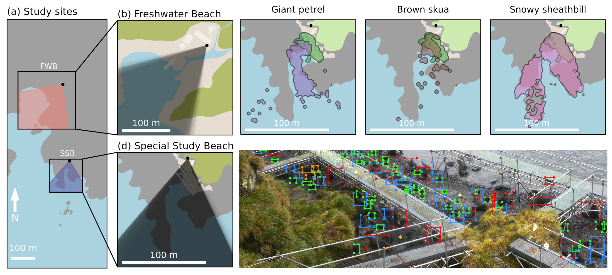

# High population density reduces predation risk in Antarctic fur seal breeding colonies

**Authors:** Johannes Bartl [](https://orcid.org/0009-0003-3647-2472),
Ane Liv Berthelsen [](https://orcid.org/0000-0001-6718-6709),
Alexander Winterl [](https://orcid.org/0000-0003-0688-9317),
Cameron Fox-Clarke,
Jaume Forcada [](https://orcid.org/0000-0002-2115-0150),
Rebecca Nagel [](https://orcid.org/0000-0002-2925-1028),
Joseph I. Hoffman [](https://orcid.org/0000-0001-5895-8949),
Ben Fabry [](https://orcid.org/0000-0003-1737-0465)

[](https://doi.org/10.5281/zenodo.23733225)
[](https://opensource.org/licenses/MIT)

<p align="center">
  
</p>

This repository contains the code, model evaluation and analysis inputs associated with the paper
**"High population density reduces predation risk in Antarctic fur seal breeding colonies"**.
Time-lapse cameras recorded two Antarctic fur seal breeding colonies at Bird Island, South Georgia
(Freshwater Beach, FWB, and Special Study Beach, SSB) at one image per minute during the 2020/21 breeding season.
A neural network detected fur seals (adult males, adult females, pups) and three bird species (giant petrels,
brown skuas, snowy sheathbills) in every image; `analysis.ipynb` turns these detections into all results,
figures and tables of the paper.

## Installation

### Prerequisites
* Python 3.10 and the packages listed in `requirements.txt`
* For training and model evaluation a GPU is recommended. We used:
  * Hardware: NVIDIA GeForce RTX 3070 (8 GB VRAM)
  * CUDA Toolkit: 11.2
  * NVIDIA Driver: 575.51

### Setup
1.  Clone the repository:
    ```bash
    git clone https://github.com/fabrylab/AntarcticFurSealDensity.git
    cd AntarcticFurSealDensity
    ```
2.  Install dependencies:
    ```bash
    pip install -r requirements.txt
    ```
3.  Download the data from Zenodo (see below) and place `FWB.csv`, `SSB.csv` and `model.pt` in the repository
    root. For training, unpack `data.zip` into `data/`.

## Repository Structure

```
AntarcticFurSealDensity/
├── analysis.ipynb                  # all analyses, figures and tables of the paper
├── training.ipynb                  # training of the YOLOv8 detection model (demo)
├── requirements.txt                # Python dependencies
├── SSB.cdb                         # manual annotations of the SSB training images
├── FWB.csv, SSB.csv, model.pt      # from Zenodo (not in the repository)
├── data/                           # from Zenodo (data.zip): annotated training images
├── assets/
│   ├── census_ssb_2020_21.xlsx     # daily field census at SSB
│   ├── cover.png                   # cover image of this README
│   ├── icons/                      # seal (Figure 3) and bird drawings (Figure 4)
│   ├── model_evaluation/           # bird test set and confusion matrices of both detection models
│   └── raw_image_lists/            # file names of all recorded images
├── map/
│   ├── FWB.* / SSB.* / both_areas.*   # georeferenced site maps
│   ├── fwb_cam.ct, ssb_cam.ct      # camera calibrations
│   ├── cameras/fwb/, cameras/ssb/  # camera calibrations of each recording period
│   ├── camera_view_FWB.jpg, camera_view_SSB.jpg   # example camera images
│   └── scaffolding_SSB.*           # scaffolding outline at SSB
├── model_evaluation/               # confusion matrix of the SSB detection model
├── figures/                        # figures written by analysis.ipynb
└── results/                        # tables written by analysis.ipynb
```

### Code & Notebooks
* **`analysis.ipynb`**: Main analysis notebook. Reproduces all statistical results, Figures 1–5, Supplementary
  Figures 1–9 and Supplementary Tables 1–3 from the detections (see *Analysis & Figures*).
* **`training.ipynb`**: Demo of the training pipeline: builds the training and validation crops from the annotated
  images in `data/`, trains and validates a YOLOv8m network with the settings of the published model (for a few
  epochs only) and applies it to a full-size image with sliced inference (SAHI). The published `model.pt` was
  additionally trained on synthetic crops with pasted birds (copy-paste augmentation), whose source images are not
  part of the published data.
* **`model_evaluation/confusion_matrix.py`**: Confusion matrix of the SSB model at the analysis confidence threshold
  (0.65) on the validation crops and the bird test set (see `model_evaluation/README.md`).
* **`requirements.txt`**: Python packages and versions.

### Models
* **`model.pt`** (Zenodo): Trained YOLOv8m weights used to predict the full SSB dataset.

### Data & Detections
* **`FWB.csv`** (Zenodo): Neural network detections at Freshwater Beach (one row per detected animal: image file
  name, timestamp, class, bounding box in pixels, GPS position and position in camera space `x_m`, `y_m`).
* **`SSB.csv`** (Zenodo): Neural network detections at Special Study Beach (same columns).
  Both files contain only images taken between 09:00 and 17:00 that passed the image-quality filter.
* **`SSB.cdb`**: Manual annotations of the 111 SSB training images in one ClickPoints database
  (comparison of manual and automated counts, Supplementary Figures 2 and 3).
* **`data/`** (Zenodo, `data.zip`): Annotated training images (`.jpg`) with their ClickPoints annotations (`.cdb`).

### Analysis inputs (`assets/`)
* **`census_ssb_2020_21.xlsx`**: Daily field census at SSB (territorial males, new females, females in the afternoon,
  cumulative pups born and dead). Only the columns used in the analysis; described in the sheet `columns`.
* **`raw_image_lists/raw_images_FWB.csv`, `raw_images_SSB.csv`**: File names and timestamps of all images recorded by
  the two cameras (image filtering, Supplementary Figure 7).
* **`model_evaluation/bird_testset_annotations.csv`, `bird_testset_images.csv`**: Bird test set of the SSB model:
  manually annotated giant petrels, brown skuas and snowy sheathbills (file name, class, bounding box in pixels) in
  SSB images not used for training, and the bird classes annotated in each image.
* **`model_evaluation/ssb_confusion_*.csv`**: Confusion matrices of the SSB model (validation crops, bird test set and
  combined), output of `model_evaluation/confusion_matrix.py`.
* **`model_evaluation/rsos_fwb_confusion_matrix.csv`**: Confusion matrix of the hierarchical FWB model (original FWB study).
* **`icons/`**: Drawings of adult male, adult female and pup Antarctic fur seals (Figure 3) and of giant petrel, brown skua and snowy sheathbill (Figure 4).
* **`cover.png`**: Cover image of this README.

### Map Data (`map/`)
* **`FWB.kml` / `FWB.png` / `FWB_v1.cdb`**: Georeferencing and annotation data for Freshwater Beach
  (aerial image, corner coordinates and map layers such as beach, rocks, water, vegetation).
* **`SSB.kml` / `SSB.png` / `SSB_v1.cdb`**: Georeferencing and annotation data for Special Study Beach.
* **`both_areas.kml` / `both_areas.png` / `both_areas_v1.cdb`**: Combined map data of both colonies (overview in Figure 1).
* **`fwb_cam.ct` / `ssb_cam.ct`**: Camera calibrations (CameraTransform) used to project detections from image to
  space and GPS coordinates.
* **`cameras/fwb/`, `cameras/ssb/`**: Camera calibration of each recording period (file names give the start and end
  of the period); fields of view in Figure 1.
* **`camera_view_FWB.jpg` / `camera_view_SSB.jpg`**: Example camera images (Figure 1).
* **`scaffolding_SSB.cdb` / `scaffolding_SSB.ct` / `scaffolding_SSB.jpg`**: Outline of the scaffolding and walkways at
  SSB, used to correct seal densities for occlusion.

## Dataset Access (Zenodo)

**Dataset DOI:** [10.5281/zenodo.23733225](https://doi.org/10.5281/zenodo.23733225)

| File | Content |
|---|---|
| `FWB.csv` | Neural network detections at Freshwater Beach |
| `SSB.csv` | Neural network detections at Special Study Beach |
| `model.pt` | Trained YOLOv8m weights |
| `data.zip` | Annotated training images (`.jpg`) and ClickPoints annotations (`.cdb`) |

## Analysis & Figures

Run `analysis.ipynb` from the repository root (with `FWB.csv` and `SSB.csv` in the root folder). A complete run
takes about 1 h on a desktop computer; figures are written to `figures/`, tables to `results/`.

| Notebook section | Output |
|---|---|
| Study sites | Figure 1 |
| Image filtering | Supplementary Figure 7 |
| Detection performance | Supplementary Figures 1, 2, 3 and 6 |
| Temporal trends in abundance at Special Study Beach | Figure 2, Supplementary Figure 4 |
| Colony-specific patterns in seal density | Figure 3, Supplementary Figure 5 |
| Abundance ratios of birds to pups (rate ratios) | Figure 4, Supplementary Figure 9 |
| Robustness of the rate ratios | Supplementary Figure 8, Supplementary Table 1 |
| Spatial associations between birds and pups | Figure 5, Supplementary Tables 2 and 3 |
